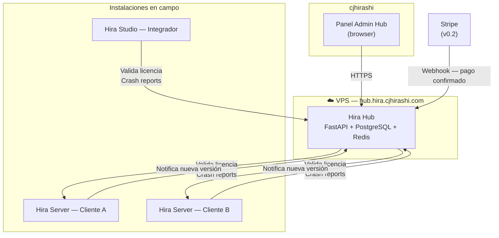

## Descripción del Sistema

Hira Hub es un servicio web backend desplegado en un VPS. Expone una API REST consumida por Hira Server y Hira Studio. No tiene frontend para integradores ni clientes — solo un Panel Admin interno para cjhirashi.

**Stack:** FastAPI + PostgreSQL + Redis + Nginx — mismo stack que Hira Server para consistencia y menor curva de mantenimiento.

---

## Diagrama de Contexto



---

## Módulos del Sistema

### v0.1 — Hub Mínimo

| Módulo | Descripción |
|---|---|
| **Gestión de Licencias** | CRUD de license keys: emisión (manual por cjhirashi en v0.1), activación, validación periódica, revocación. License key atada a instalación |
| **Recepción de Crash Reports** | Endpoint que recibe stack traces sanitizados de Server/Studio. Almacena, agrupa por tipo, y los expone en Panel Admin para revisión |
| **Registro de Versiones** | cjhirashi publica nueva versión → Hub la registra → Servers y Studios consultan `/api/updates/latest` y notifican al integrador si hay update disponible |
| **Panel Admin** | UI web simple para cjhirashi: lista de licencias activas, crash reports sin revisar, métricas básicas |
| **Health** | Endpoint público `/health` para UptimeRobot |

### v0.2 — Hub con Ventas

| Módulo | Descripción |
|---|---|
| **Portal de Ventas** | Página pública donde el integrador compra licencias Server/Studio con Stripe. Tras pago confirmado (webhook), Hub emite y envía la key por email |
| **Dashboard de Instalaciones** | Vista para cjhirashi: qué integradores tienen licencias activas, cuántas instalaciones por integrador, próximos vencimientos |

### v0.3 — Diseñador de Bloques

| Módulo | Descripción |
|---|---|
| **Marketplace de Plantillas** | Catálogo de pre-ingenierías `.hirat` — gratuitas, de pago (comisión Hub), y oficiales cjhirashi. Studio las descarga e importa como punto de partida de un proyecto nuevo |
| **Diseñador de Bloques SVG** | Editor visual para cjhirashi donde diseña nuevos bloques SVG HVAC (Fan, Chiller, etc.) y los publica al catálogo descargable por los Servers activos |

---

## Architecture Decision Records

### -1 — Mismo stack que Hira Server (FastAPI + PostgreSQL + Redis)

- **Contexto:** Hub es un proyecto de solo cjhirashi. Reducir la cantidad de tecnologías que mantener es crítico
- **Decisión:** FastAPI + PostgreSQL + Redis. Mismo stack que Server — mismo dominio, mismo conocimiento, mismas herramientas de debug
- **Alternativas:** Node.js (más popular en SaaS), Django (más baterías incluidas)
- **Consecuencias:** Código reutilizable entre proyectos; un solo lenguaje para todo el ecosistema; menor superficie de mantenimiento

### -2 — License keys opacas y validadas contra hash

- **Contexto:** Las license keys viajan en requests desde instalaciones de campo. No deben revelar información interna ni ser predecibles
- **Decisión:** Keys aleatorias de formato `HIRA-XXXX-XXXX-XXXX-XXXX` generadas con `secrets.token_hex`. Almacenadas como hash en BD (bcrypt). La validación compara el hash — nunca se almacena ni loguea la key en claro
- **Alternativas:** Keys con encoding de metadata (tipo Stripe `sk_live_...`)
- **Consecuencias:** Seguridad por defecto; si la BD se filtra, las keys no son recuperables; la key se muestra UNA sola vez al emitirse — si el integrador la pierde, se emite una nueva

### -3 — Grace period de 72h para Servers sin conexión a Hub

- **Contexto:** Si Hub cae, los Servers de los clientes no deben dejar de operar. El SCADA es crítico para la operación del cliente
- **Decisión:** Al validar la licencia exitosamente, Server almacena el timestamp de la última validación. Si Hub no está accesible, Server sigue operando hasta 72h desde la última validación exitosa antes de entrar en modo degradado (solo lectura, sin configuración)
- **Alternativas:** Sin grace period (Server cae si Hub cae); grace period indefinido (licencia nunca expira en la práctica)
- **Consecuencias:** El uptime de Hub no bloquea el SCADA del cliente; cjhirashi tiene 72h para restaurar Hub antes de que integradores se vean afectados

### -5 — Arquitectura directa (no Hexagonal)

- **Contexto:** La 02.2 - Metodología General de Proyectos exige documentar explícitamente la decisión de arquitectura del backend — ya sea Hexagonal o alternativa con justificación
- **Decisión:** Hub usa arquitectura **directa** (no hexagonal). Estructura: `core/` + `models/` + `schemas/` + `routers/` + `services/`. No hay puertos ni adaptadores
- **Por qué no Hexagonal:** Hub tiene un único deployment target: VPS en producción. No hay variantes de despliegue (no existe versión embedded, edge, multi-cloud). La complejidad de la capa de puertos/adaptadores no agrega valor — agrega superficie de mantenimiento para un solo operador sin beneficio práctico
- **Alternativas:** Arquitectura Hexagonal (descartada — sobre-ingeniería para este caso de uso)
- **Consecuencias:** Código más simple y directo; menor carga cognitiva para cjhirashi como único mantenedor; si en el futuro Hub requiere variantes de deployment, se refactoriza a hexagonal en ese momento con contexto real de necesidad

### -4 — Crash reports opt-in con datos sanitizados

- **Contexto:** Los Servers corren en redes privadas de clientes. Enviar datos técnicos al exterior requiere consentimiento explícito del integrador
- **Decisión:** `CRASH_REPORTER_ENABLED=false` por defecto. El integrador lo activa desde el panel con un texto de consentimiento explícito. Los crash reports contienen SOLO: versión de Hira, módulo afectado, stack trace de código propio (no de datos del cliente), timestamp. NUNCA: IPs, nombres de dispositivos, valores de puntos, datos de usuarios
- **Alternativas:** Opt-out (activo por defecto); siempre activo sin opción
- **Consecuencias:** Confianza del integrador; cumplimiento de expectativas de privacidad; menor volumen de reports (solo de quienes consientan)

---

## Flujos Principales

### Validación de licencia (Server arranca)

```
Server arranca
  → Lee LICENSE_KEY de .env
  → POST /api/licenses/validate {key, hardware_fingerprint, version}
  → Hub verifica hash de key en BD
  → Hub registra: última validación, versión en campo, hardware
  → Hub responde: {valid: true, expires_at, features}
  → Server almacena timestamp de validación exitosa (grace period)
  → Si Hub no responde: Server verifica grace period (< 72h) → continúa operando
```

### Crash report automático

```
Server detecta excepción no recuperada
  → Si CRASH_REPORTER_ENABLED=true
  → Sanitiza stack trace (elimina valores de BD, IPs, datos de usuario)
  → POST /api/crash-reports {version, module, stack_trace, timestamp}
  → Hub almacena y agrupa por hash de stack trace
  → Panel Admin muestra "3 reports nuevos" a cjhirashi
```

### Publicación de actualización

```
cjhirashi hace git tag v0.X.X
  → GitHub Actions construye y publica imágenes Docker
  → cjhirashi registra nueva versión en Panel Admin Hub
  → Servers y Studios consultan GET /api/updates/latest periódicamente
  → Si hay versión nueva: Panel Admin del Server muestra notificación
  → Integrador decide cuándo actualizar
```

---

## Gate de Salida

- [x] Módulos por versión definidos
- [x] ADRs documentados
- [x] Flujos principales claros
- [ ] Revisado y aprobado por Charlie
