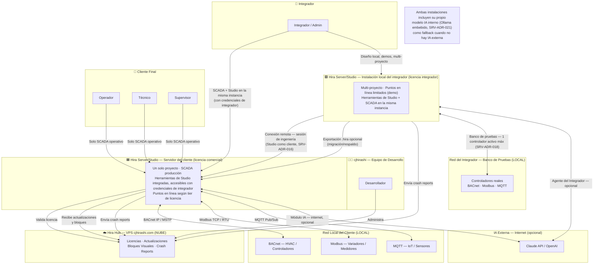
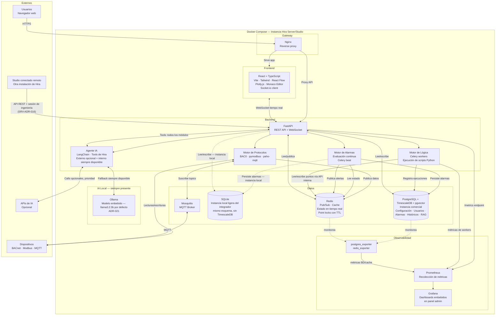

## Descripción del Sistema

**Hira** es un ecosistema de dos productos: **Hira Server/Studio** (un solo producto, un solo instalador — ver SRV-ADR-015) y **Hira Hub** (plataforma cloud).

### Hira Server/Studio

Un solo código base, un solo instalador. Se instala en dos contextos posibles:

- **En la PC del integrador (licencia de integrador):** instancia local, para diseño, demos y trabajo sin depender del cliente. Soporta múltiples proyectos (ver SRV-ADR-020). Puntos en línea limitados a un tope de demo (ver SRV-ADR-018).
- **En el servidor del cliente (licencia comercial):** instancia de producción, un solo proyecto por servidor. Puntos en línea según el tier contratado (Starter/Professional/Enterprise).

**Hira Studio** es la herramienta de diseño e ingeniería sobre los proyectos que viven en un Server — nunca opera aislada, siempre conectada a un Server (local o remoto, ver SRV-ADR-016). El integrador, con sus credenciales, tiene acceso simultáneo a las herramientas operativas (SCADA) y de ingeniería (Studio) dentro de la misma instalación.

### Hira Hub

Componente cloud del ecosistema — VPS en cjhirashi.com. Valida licencias, distribuye actualizaciones, recibe crash reports y en versiones futuras aloja el marketplace de plantillas. No visible para integradores ni clientes. Ver `7.2 - ÍNDICE - Hira Hub` para toda la documentación de Hub.

---

## Diagrama de Contexto (C4 L1) — Ecosistema Hira

Cada instalación (local o servidor) incluye siempre su propio contenedor Ollama embebido como fallback — no depende de `IA_EXT` para operar con asistencia IA básica (ver SRV-ADR-021 y diagrama de contenedores abajo).

---

## Diagrama de Contenedores (C4 L2)

`adapters/factory.py` selecciona PostgreSQL o SQLite según el perfil de despliegue (ver SRV-ADR-017 — Arquitectura Hexagonal). El resto del stack (Redis, Motor de Protocolos, Motor de Lógica, Motor de Alarmas) es idéntico en ambos perfiles.

---

## Módulos del Sistema

| # | Módulo | Descripción |
|---|---|---|
| 1 | **Motor de Protocolos** | Comunicación con dispositivos BACnet, Modbus y MQTT. Polling configurable por punto asociado (ver SRV-ADR-019). Publica lecturas a Redis |
| 2 | **Motor de Alarmas** | Evalúa condiciones de alarma en tiempo real. Gestiona estados (activa, reconocida, resuelta), prioridades y notificaciones |
| 3 | **Históricos** | Almacena series de tiempo en TimescaleDB (o SQLite en instancia local). Configurable por punto: frecuencia, retención, compresión |
| 4 | **Configurador** | Panel admin para definir dispositivos, puntos, mimics gráficos, paneles de control, roles y usuarios sin tocar código |
| 5 | **Motor de Lógica** | Scripts Python de **operación continua** con API interna (`hira.read/write/subscribe`), editados en Monaco Editor. Celery los ejecuta indefinidamente en cola de prioridad normal. Se pausan automáticamente cuando una prueba bloquea sus puntos |
| 6 | **Motor de Pruebas** | Scripts Python de **ejecución única o acotada** para pruebas funcionales y de comisionamiento. Corren en cola Celery de alta prioridad. Bloquean en Redis los puntos que usan |
| 7 | **Módulo de Análisis** | Exploración de históricos, visualización de resultados de pruebas, comparación de comportamientos, generación de reportes PDF/CSV |
| 8 | **Agente IA** | Dos instancias independientes de LangChain (ver SRV-ADR-013): Agente del Integrador (construcción del proyecto) y Agente del Cliente (operación, con RAG sobre documentación). Cada una usa modelo externo si está configurado, o el modelo interno embebido (Ollama, ver SRV-ADR-021) como fallback siempre disponible |
| 9 | **Módulo de Documentación** | Centro de conocimiento técnico del proyecto — consumido por usuarios y por el Agente IA como base RAG (ver SRV-ADR-011) |
| 10 | **Módulo de Monitoreo y Notificaciones** | Métricas operativas del sistema, métricas de agentes IA, y sistema de notificaciones en dos canales (integrador y desarrollador) |
| 11 | **Backup y Portabilidad** | Exportación/importación de paquete `.hira` (opcional, para mover proyectos entre instalaciones — ver SRV-ADR-015), backup automatizado, replicación activo-pasivo |
| 12 | **Gestión de Usuarios** | RBAC dinámico — usuarios de operación por proyecto, usuarios integrador globales a la instancia (ver SRV-ADR-020) |
| 13 | **Licenciamiento** | License key atada al hardware. Distingue licencia de integrador (multi-proyecto, puntos en línea limitados) de licencia comercial (un proyecto, puntos en línea según tier) — ver SRV-ADR-018 |

---

## Gate de Salida

- [x] Arquitectura conceptual validada con el modelo de un solo producto (SRV-ADR-015)
- [x] Diagramas C4 actualizados con el modelo IA interno (SRV-ADR-021)
- [x] Módulos del sistema coherentes con los ADRs vigentes
- [ ] Revisado y aprobado por Charlie
