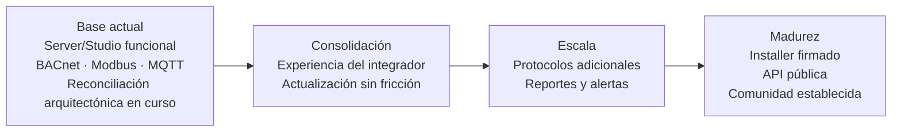
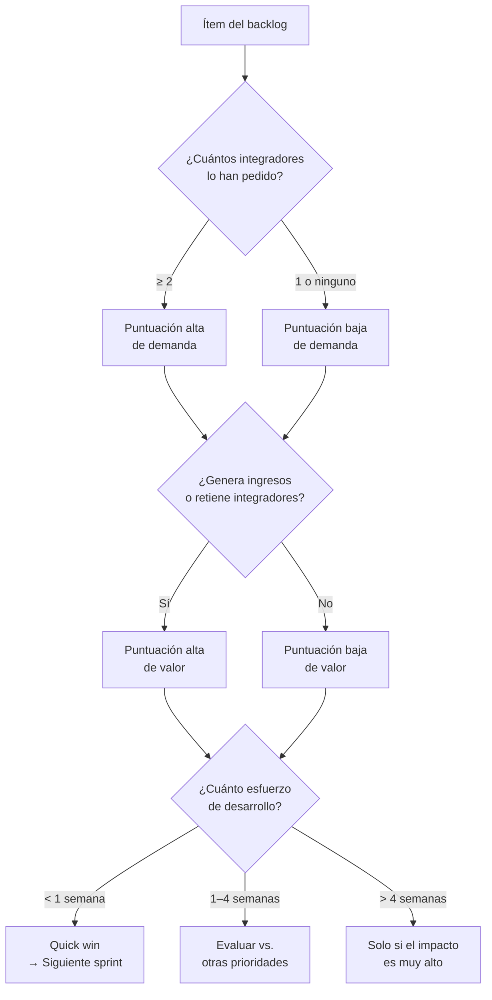
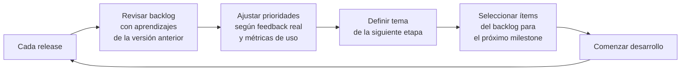

## Alcance

Roadmap de evolución de Hira Server/Studio más allá de lo ya diseñado y de la reconciliación arquitectónica pendiente (ver `.harness/coordination/sprint-history.md`). Captura qué viene después, en qué orden y por qué — sin comprometerse a fechas que no existen todavía. El backlog es un sistema vivo: crece con cada incidencia, cada feedback de integrador y cada oportunidad de mercado detectada.

**Nota:** ítems que ya forman parte del diseño vigente (multi-proyecto y sesión de ingeniería remota, ver SRV-ADR-020 y SRV-ADR-016) o que ya están implementados (Modbus TCP/RTU, Sprint 17; replicación L3, `.harness/spec/hira-server/modules/backup-y-portabilidad.md`) no aparecen aquí — su seguimiento vive en `.harness/coordination/sprint-history.md`, no en este backlog de producto.

---

## Visión de Evolución del Producto

Cada etapa tiene un **tema central** — no es una lista de features sino una dirección clara que guía qué entra y qué espera.

---

## Roadmap por Etapa

### Consolidación de la Experiencia del Integrador

**Tema:** hacer que el integrador quiera usar Hira en su segundo proyecto sin que se lo pidamos.

| ID | Mejora | Categoría | Justificación |
|---|---|---|---|
| MJR-010 | Botón "Actualizar" en panel Admin — sin terminal | UX / Despliegue | Actualizar hoy requiere que el integrador ejecute un script. Con usuarios reales esto es fricción crítica |
| MJR-011 | Notificación en panel cuando hay nueva versión disponible | UX | El integrador necesita saber que hay update sin que cjhirashi lo contacte manualmente |
| MJR-012 | Configuración de retención de históricos desde el panel | UX | Sin esto, el disco del servidor del cliente se llena sin aviso |
| MJR-013 | Reporte de salud del proyecto exportable para el cliente final | Feature | El integrador quiere mostrarle un reporte de salud al cliente — el dashboard interno del Sprint 15 es para el integrador, no para compartir |
| MJR-016 | Plantillas de proyecto | Feature | Acelera los proyectos nuevos — Fan&Coil, HVAC básico, iluminación — sin empezar desde cero |
| MJR-017 | Mejoras de UX en el configurador BACnet basadas en feedback de campo | UX | Los puntos de fricción reales solo se conocen con integradores usando el sistema |

### Escala y Ecosistema

**Tema:** hacer que Hira crezca solo — a través de integradores que traen a otros integradores y fabricantes que traen sus redes.

| ID | Mejora | Categoría | Justificación |
|---|---|---|---|
| MJR-022 | Soporte OPC-UA | Expansión técnica | Amplía el mercado a industria pesada y edificios más complejos |
| MJR-023 | Soporte KNX | Expansión técnica | Mercado SmartBuildings europeo y proyectos de domótica de alto nivel |
| MJR-024 | Reportes automáticos programables (PDF semanal/mensual) | Feature | El cliente final quiere un reporte de operación sin que el operador lo genere manualmente |
| MJR-025 | Notificaciones por WhatsApp Business API | Feature | En LATAM el operador no revisa email — WhatsApp es el canal real de alertas |
| MJR-026 | Vista consolidada de múltiples instalaciones remotas desde una sola sesión | Feature | El integrador con 10+ instalaciones necesita monitoreo agregado, más allá de conectarse una a la vez vía sesión de ingeniería (SRV-ADR-016) |

### Madurez del Producto

**Tema:** producto que compite directamente con Ignition y Niagara en experiencia, a una fracción del precio.

| ID | Mejora | Categoría | Justificación |
|---|---|---|---|
| MJR-030 | Installer .exe para Windows con firma de código | Despliegue | Elimina el último punto de fricción en la instalación — SmartScreen bloqueando el script |
| MJR-031 | App móvil iOS/Android para monitoreo | Feature | El operador quiere ver el estado del edificio desde su teléfono fuera del horario de trabajo |
| MJR-032 | API pública REST documentada para integraciones de terceros | Platform | Abre Hira a integraciones con BMS, ERP, sistemas de ticketing — terceros construyen sobre Hira |
| MJR-033 | Editor visual FBD (Function Block Diagram) como alternativa al script Python | Feature | Integradores no programadores pueden crear lógica de control sin código (ver SRV-ADR-007) |
| MJR-034 | Certificación de integradores Hira (programa de partners) | Negocio | Modelo Ignition — integradores certificados como canal comercial validado |

---

## Proceso de Priorización

Antes de mover cualquier ítem del backlog al roadmap activo, se evalúa con cuatro preguntas:

### Fuentes del backlog

| Fuente | Tipo de información |
|---|---|
| **Feedback de integradores** | Puntos de fricción reales, features que frenan adopción |
| **Crash reports y SEV-1/2** | Bugs que se convierten en mejoras de robustez — ver `.harness/spec/hira-server/incidents/` |
| **Análisis de mercado** | Qué tienen Ignition/Niagara que Hira no tiene |
| **Oportunidades detectadas por cjhirashi** | Ideas estratégicas — marketplace, fabricantes, protocolos |
| **Métricas de uso** | Qué módulos se usan más, dónde pasan más tiempo |

---

## Backlog Completo

| ID | Mejora | Etapa | Prioridad | Estado |
|---|---|---|---|---|
| MJR-010 | Botón "Actualizar" en panel Admin | Consolidación | Alta | Pendiente |
| MJR-011 | Notificación de versión nueva en panel | Consolidación | Alta | Pendiente |
| MJR-012 | Retención de históricos configurable desde panel | Consolidación | Alta | Pendiente |
| MJR-013 | Reporte de salud exportable para el cliente | Consolidación | Media | Pendiente |
| MJR-016 | Plantillas de proyecto | Consolidación | Media | Pendiente |
| MJR-017 | UX configurador BACnet (post-feedback de campo) | Consolidación | Alta | Pendiente |
| MJR-022 | Soporte OPC-UA | Escala | Media | Pendiente |
| MJR-023 | Soporte KNX | Escala | Baja | Pendiente |
| MJR-024 | Reportes PDF automáticos programables | Escala | Media | Pendiente |
| MJR-025 | Notificaciones por WhatsApp Business API | Escala | Media | Pendiente |
| MJR-026 | Vista consolidada multi-instalación | Escala | Media | Pendiente |
| MJR-030 | Installer .exe con firma de código (Windows) | Madurez | Alta | Pendiente |
| MJR-031 | App móvil iOS/Android | Madurez | Media | Pendiente |
| MJR-032 | API pública REST documentada | Madurez | Alta | Pendiente |
| MJR-033 | Editor visual FBD | Madurez | Media | Pendiente |
| MJR-034 | Programa de certificación de integradores | Madurez | Alta | Pendiente |

---

## Mejoras Incorporadas desde Incidencias

*Se puebla cuando una incidencia SEV-1 o SEV-2 genera una mejora — ver `.harness/spec/hira-server/incidents/`.*

| Incidencia | Mejora generada | ID | Etapa objetivo |
|---|---|---|---|
| — | — | — | — |

---

## Mejoras Incorporadas desde Feedback de Integradores

*Se registra cada solicitud recibida, aunque no entre al roadmap inmediatamente.*

| Fecha | Integrador | Solicitud | Decisión | ID si aplica |
|---|---|---|---|---|
| — | — | — | — | — |

---

## Ciclo de Revisión del Roadmap

El roadmap no es un contrato — es una hipótesis sobre qué le da más valor al ecosistema en este momento. Se revisa en cada release con la información real de los integradores y el mercado.

---

## Gate de Salida

Este documento no tiene gate de salida fijo — es un registro vivo. Los indicadores de madurez son:

- [ ] Al menos 3 ítems validados por feedback de integrador real
- [ ] Backlog con origen documentado para cada ítem (no se agrega nada sin justificación)
- [ ] Al menos 1 mejora incorporada desde una incidencia real
- [ ] Ciclo de revisión ejecutado al menos una vez tras el primer release
