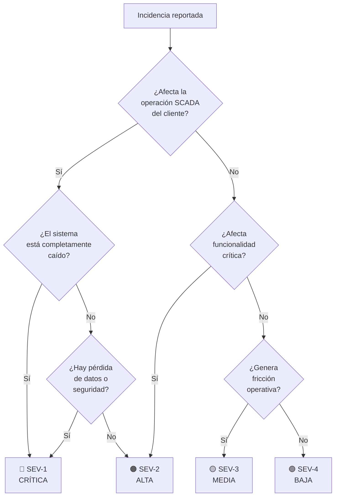
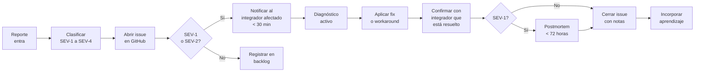

## Clasificación de Incidencias



### Definición de severidades

| Severidad | Descripción | Ejemplos | Tiempo de respuesta |
|---|---|---|---|
| 🔴 **SEV-1 Crítica** | Sistema SCADA del cliente completamente inoperativo o pérdida de datos | Backend caído, BD corrupta, pérdida de históricos, brecha de seguridad | < 2 horas |
| 🟠 **SEV-2 Alta** | Funcionalidad crítica degradada pero el sistema sigue operando | Motor de alarmas no notifica, WebSocket caído (no hay tiempo real), BACnet sin polling | < 8 horas |
| 🟡 **SEV-3 Media** | Funcionalidad afectada pero con workaround disponible | Export `.hira` falla, Agente IA no responde, gráfica histórica no carga | < 48 horas |
| 🟢 **SEV-4 Baja** | Problema menor, cosmético o de UX | Texto incorrecto en UI, formato de fecha en CSV, icono equivocado | Próximo sprint |

---

## Proceso de Respuesta



### Paso 1 — Recibir y clasificar

Todas las incidencias entran por uno de estos canales:
- **Crash report automático** → Hira Hub recibe el stack trace de la instalación afectada (ver `.harness/spec/hira-server/modules/monitoreo-y-notificaciones.md`)
- **Email del integrador** → reporte manual con descripción del problema
- **Detección propia** → cjhirashi detecta anomalía en logs de Hub o monitoreo

Clasificar la severidad en los primeros 15 minutos. En caso de duda, asumir la severidad más alta y ajustar después.

### Paso 2 — Abrir issue en GitHub

Todo incidente SEV-1 a SEV-3 genera un issue en GitHub con la plantilla:

```markdown
**Severidad:** SEV-X
**Producto afectado:** Hira Hub / Hira Server-Studio
**Versión:** vX.X.X
**Perfil de instalación:** Local del integrador / Producción comercial
**Instalación afectada:** [ID o nombre del integrador]
**Descripción:** [Qué está pasando]
**Pasos para reproducir:** [Si se conocen]
**Crash report ID:** [Si existe]
**Impacto:** [Cuántos clientes/instalaciones afectadas]
```

### Paso 3 — Comunicar al integrador (SEV-1 y SEV-2)

El integrador debe saber en menos de 30 minutos que el problema fue recibido y está siendo atendido. El mensaje no necesita tener la solución — solo confirmar que se está trabajando.

```
Asunto: [Hira] Incidencia recibida — [descripción breve]

Hola [integrador],

Recibí tu reporte sobre [problema]. Lo estoy revisando ahora mismo.
Te contacto en cuanto tenga diagnóstico.

— cjhirashi
```

### Paso 4 — Diagnóstico y resolución

Herramientas de diagnóstico disponibles:

| Fuente | Qué encontrar ahí |
|---|---|
| Crash report en Hira Hub | Stack trace sanitizado con contexto del error |
| Logs del backend (`docker logs hira-backend`) | Errores de runtime, queries lentas, excepciones |
| Logs de Nginx | Errores 4xx/5xx, latencias inusuales |
| Panel Admin → Sistema de la instalación afectada | Estado de servicios, uso de recursos |
| Histórico de GitHub Actions | Si el bug se introdujo en un deploy reciente |

### Paso 5 — Fix o workaround

Para SEV-1 y SEV-2: primero un **workaround inmediato** que restaure la operación del cliente, luego el fix definitivo en un hotfix release.

Para SEV-3 y SEV-4: el fix va al siguiente sprint normal, sin urgencia de workaround.

### Paso 6 — Confirmación de cierre

No cerrar el issue hasta que el integrador confirme que el problema está resuelto. Si no responde en 48 horas, cerrar con nota.

---

## Gate de Salida

- [ ] Proceso probado con al menos una incidencia real
- [ ] Plantilla de issue en uso en GitHub
