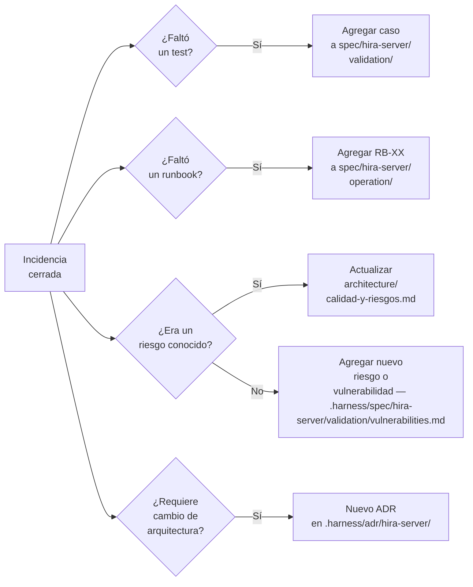

## Postmortem (SEV-1 obligatorio)

Todo incidente SEV-1 genera un postmortem documentado en menos de 72 horas del cierre. El postmortem se añade al Registro de Postmortems de este documento.

**Estructura del postmortem:**

```markdown
### INC-XXX — [Título]

**Fecha:** YYYY-MM-DD
**Severidad:** SEV-1
**Duración:** X horas X minutos
**Productos afectados:** [Hira Hub / Hira Server-Studio vX.X.X]
**Instalaciones afectadas:** X instalaciones

**Línea de tiempo:**
- HH:MM — [Evento]
- HH:MM — [Evento]
- HH:MM — Servicio restaurado

**Causa raíz:**
[Descripción técnica precisa de qué falló y por qué]

**Por qué no lo detectamos antes:**
[Qué faltó en monitoreo, tests o validación]

**Qué se hizo para resolverlo:**
[Fix aplicado o workaround usado]

**Acciones correctivas:**
- [ ] [Acción concreta para prevenir recurrencia] — responsable: cjhirashi — fecha límite: YYYY-MM-DD

**¿Se incorporó a Validación?**
[ ] Sí — nuevo criterio de aceptación: [CA-XX] en `.harness/spec/hira-server/validation/acceptance-criteria.md`
[ ] No aplica
```

---

## Registro de Incidencias

*Se completa con cada incidencia a partir del primer despliegue en producción.*

| ID | Fecha | SEV | Producto | Versión | Descripción | Estado | Postmortem |
|---|---|---|---|---|---|---|---|
| — | — | — | — | — | — | — | — |

---

## Registro de Postmortems

*Se añade una entrada por cada SEV-1 cerrado.*

*(Sin postmortems — sistema en desarrollo)*

---

## Métricas de Incidencias

*Se calculan mensualmente a partir del primer mes en producción.*

| Métrica | Definición | Objetivo |
|---|---|---|
| MTTD | Mean Time to Detect — desde que ocurre hasta que se detecta | < 15 min para SEV-1 |
| MTTR | Mean Time to Resolve — desde detección hasta restauración | < 2h para SEV-1 / < 8h para SEV-2 |
| Tasa de recurrencia | % de incidencias con la misma causa raíz | < 10% |
| Incidencias por versión | Número de SEV-1+2 por release | Tendencia decreciente |

---

## Aprendizaje Continuo

Cada incidencia cerrada debe generar al menos una de estas salidas:



La documentación del proyecto es un sistema vivo. Cada incidencia es información que mejora el producto si se captura correctamente.

---

## Gate de Salida

Este documento no tiene un gate de salida fijo — es un registro operativo continuo. Los criterios de madurez son:

- [ ] Al menos 3 incidencias reales documentadas con proceso completo
- [ ] Al menos 1 postmortem completado con acciones correctivas implementadas
- [ ] MTTR promedio de SEV-1 en tendencia decreciente entre versiones
- [ ] Cada incidencia SEV-1 resultó en al menos un criterio de aceptación nuevo en `.harness/spec/hira-server/validation/acceptance-criteria.md`
