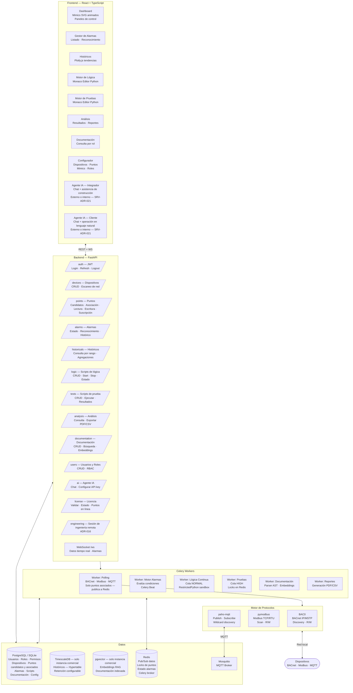

## Stack Tecnológico

| Componente | Tecnología | Versión | Justificación |
|---|---|---|---|
| Backend framework | FastAPI | Latest stable | Asíncrono, WebSocket nativo, ecosistema Python completo |
| Comunicación BACnet | BAC0 | Latest stable | Librería más madura para BACnet en Python, soporta IP y MSTP |
| Comunicación Modbus | pymodbus | Latest stable | Estándar de facto para Modbus TCP/RTU en Python |
| Comunicación MQTT | paho-mqtt | Latest stable | Librería oficial Eclipse para MQTT client |
| MQTT Broker | Mosquitto | Latest stable | Broker MQTT ligero, contenedor dedicado en Docker Compose |
| Base de datos (instancia comercial) | PostgreSQL + TimescaleDB + pgvector | 16+ | Relacional + series de tiempo + vectores RAG — un solo motor, tres extensiones |
| Base de datos (instancia local del integrador) | SQLite | Latest stable | Mismo esquema relacional, sin TimescaleDB — ver SRV-ADR-017 |
| Cache / Pub-Sub | Redis | 7+ | Bus de datos en tiempo real, bloqueo de puntos, estado de alarmas |
| Tareas background | Celery + Redis | Latest stable | Colas `high` (pruebas) y `normal` (lógica), polling, alarmas, reportes |
| Métricas | Prometheus + prometheus_client | Latest stable | Recolección de métricas del sistema, dispositivos y agentes IA — expuesto en `/metrics` |
| Dashboards | Grafana | Latest stable | Visualización de métricas, embebible en panel admin vía iframe, datasource Prometheus |
| DB metrics | postgres_exporter + redis_exporter | Latest stable | Exportan métricas internas de PostgreSQL y Redis a Prometheus |
| Sandboxing de scripts | RestrictedPython | Latest stable | Ejecución segura de scripts Python del integrador — acceso solo a API interna de Hira |
| Editor de código | Monaco Editor | Latest stable | Editor Python embebido en panel admin, mismo motor que VS Code |
| Frontend framework | React + TypeScript | 18+ | Componentes reutilizables, tipado estricto |
| Build tool | Vite | Latest stable | Compilación rápida, HMR en desarrollo |
| Estilos | Tailwind CSS | 3+ | Utilitario, consistente, sin CSS externo |
| Editor visual | React Flow | Latest stable | Canvas drag-and-drop para mimics, diagramas de conexionado y futuro FBD |
| Gráficos de equipos | SVG animado + React | — | Componentes React con SVG animado enlazados a puntos en tiempo real |
| Gráficas de tendencias | Plotly.js | Latest stable | Gráficas interactivas 100% local, sin CDN |
| Tiempo real cliente | Socket.io | Latest stable | WebSocket bidireccional para datos y alarmas en tiempo real |
| IA — orquestación | LangChain | Latest stable | Dos instancias: Agente Integrador + Agente Cliente |
| IA — modelos externos | Claude API · OpenAI API · Ollama externo | — | Configurable por instancia; el sistema opera sin ninguno activo |
| IA — modelo interno (fallback) | Ollama embebido | `llama3.2:3b` por defecto | Contenedor incluido siempre en el compose, sin configuración — cubre la ausencia de modelo externo (ver SRV-ADR-021) |
| RAG — embeddings | LangChain + pgvector | — | Indexación y búsqueda semántica sobre documentación del proyecto |
| Infraestructura | Docker + Docker Compose | Latest stable | Mismo compose en Linux (Docker Engine) y Windows (Docker Desktop + WSL2) |
| Reverse proxy | Nginx | Latest stable | Sirve frontend estático, proxy al backend, terminación SSL |
| Licenciamiento | Python backend custom | — | License key atada a hardware (MAC address + hostname); valida puntos en línea contra tier (ver SRV-ADR-018) |
| Control de acceso | RBAC dinámico en base de datos | — | Roles y permisos configurables: módulos, áreas, tipo de acceso; alcance por proyecto o global según tipo de usuario (ver SRV-ADR-020) |

---

## Diagrama de Componentes (C4 L3)

`adapters/factory.py` selecciona PostgreSQL o SQLite según `HIRA_DEPLOY_MODE` (ver SRV-ADR-017). El Motor de Protocolos solo hace polling y escritura sobre puntos asociados — nunca sobre candidatos crudos del escaneo (ver SRV-ADR-019).

---

## Gate de Salida

- [x] Stack definido y justificado
- [x] Diagrama de componentes actualizado con puntos candidatos/asociados y sesión de ingeniería
- [x] Modelo IA interno (Ollama embebido, SRV-ADR-021) incorporado al stack
- [ ] Revisado y aprobado por Charlie
