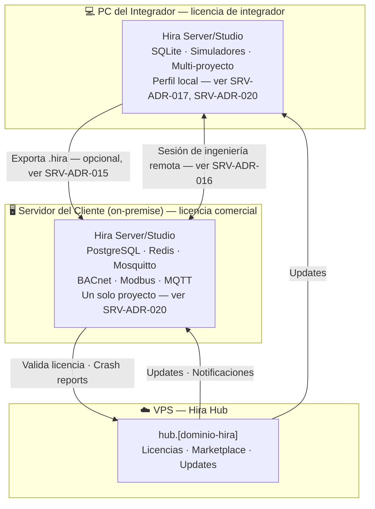
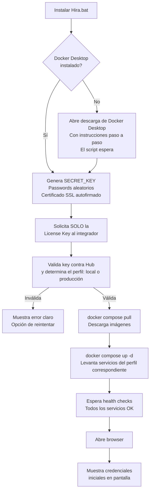
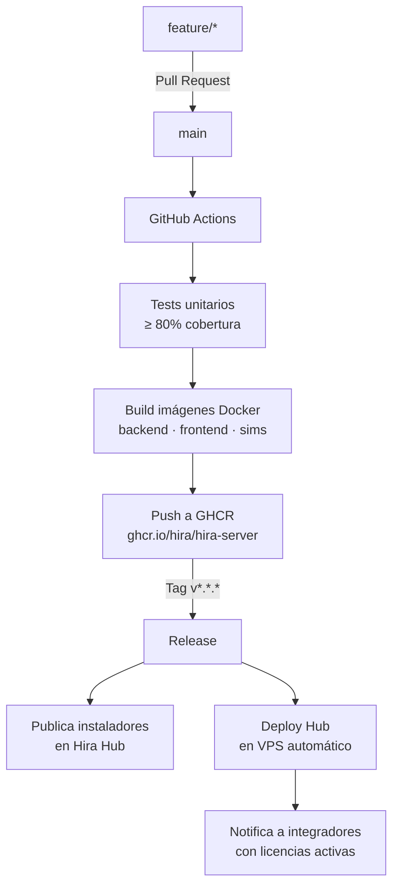

## Principio Rector

**El integrador solo debe ver su clave de licencia — nunca Docker, nunca un archivo de configuración, nunca una terminal.** Un solo instalador (ver SRV-ADR-015); lo que cambia según la clave de licencia ingresada es el perfil resultante (local ligero vs. producción — ver SRV-ADR-017).

> Hira Hub (VPS cloud) tiene su propio documento de despliegue en `7.2 - ÍNDICE - Hira Hub`.

---

## Topología del Ecosistema



---

## Instalación de Hira Server/Studio

Mismo instalador en ambos contextos. El integrador descarga, ejecuta, entra su clave de licencia — el sistema queda listo sin que el integrador toque Docker, archivos de configuración ni terminal (salvo el one-liner de instalación en Linux).

### En la PC del integrador (licencia de integrador)

**Windows:**
```
1. Descarga "Hira Server-Studio vX.X.X — Windows.zip" desde Hira Hub
2. Descomprime → doble click en "Instalar Hira.bat"

┌──────────────────────────────────────────────────┐
│           Hira Server/Studio — Instalación        │
│                                                    │
│  Verificando Docker Desktop...            ✅      │
│  Configurando perfil local (SQLite)...    ✅      │
│  Activando simuladores...                 ✅      │
│                                                    │
│  Ingresa tu clave de licencia de integrador:      │
│  > HIRA-INT-XXXX-XXXX-XXXX                       │
│                                                    │
│  ✅ Listo — perfil local, multi-proyecto activo   │
│  Abriendo en tu navegador...                      │
└──────────────────────────────────────────────────┘

3. Browser abre en http://localhost:3000 → Biblioteca de Proyectos (ver .harness/spec/hira-server/ui-ux/especificacion-de-vistas.md)
```

**Arranque diario:** acceso directo en el escritorio → `docker compose start` en background → browser abre en segundos. El integrador no necesita abrir Docker Desktop ni terminal.

### En el servidor del cliente (licencia comercial)

**Windows:**
```
1. Descarga "Hira Server-Studio vX.X.X — Windows.zip" desde Hira Hub
2. Descomprime → doble click en "Instalar Hira.bat"

┌──────────────────────────────────────────────────┐
│           Hira Server/Studio — Instalación        │
│                                                    │
│  Verificando Docker Desktop...            ✅      │
│  Generando configuración segura...        ✅      │
│  Descargando componentes...               ⏳      │
│                                                    │
│  Ingresa tu clave de licencia:                    │
│  > HIRA-XXXX-XXXX-XXXX-XXXX                      │
│                                                    │
│  Validando con Hira Hub...                ✅      │
│  Iniciando servicios (perfil producción)...✅      │
│                                                    │
│  ✅ Hira Server/Studio instalado correctamente     │
│  Abriendo el sistema en tu navegador...           │
└──────────────────────────────────────────────────┘

3. El browser se abre automáticamente en https://localhost
4. Login con credenciales iniciales mostradas en pantalla
```

**Linux (ambos contextos):**
```bash
curl -fsSL https://hub.[dominio-hira]/install | bash
```
El script interactivo guía igual que la versión Windows y detecta el perfil según el tipo de clave ingresada.

### Lo que hace el script por dentro (invisible al integrador)



### Requisito previo — Docker Desktop

El integrador lo instala **una sola vez en su vida** — tanto su instalación local como cualquier instalación comercial que despliegue lo reutilizan como requisito.

- Windows: [docker.com/products/docker-desktop](https://docker.com/products/docker-desktop) → instalador gráfico estándar
- Linux: el script de instalación lo instala automáticamente si no existe

### Lo que el integrador nunca ve

| Concepto | Cómo se maneja |
|---|---|
| Passwords de BD, Redis, MQTT | Generados automáticamente con `openssl rand` |
| SECRET_KEY de la aplicación | Generada automáticamente |
| Certificado SSL | Autofirmado generado en instalación (perfil producción) |
| Archivo `.env` | Creado y gestionado por el script |
| Comandos Docker | Ejecutados por el script en background |
| Migraciones de BD | Corren automáticamente al primer arranque (Alembic) |

### Diferencias por perfil de instalación

| Aspecto | Perfil local (integrador) | Perfil producción (comercial) |
|---|---|---|
| Base de datos | SQLite | PostgreSQL + TimescaleDB + Redis |
| Simuladores | Incluidos y activos desde el arranque | Sin simuladores en producción |
| SSL | HTTP local (no necesita HTTPS) | HTTPS con certificado autofirmado |
| Proyectos | Multi-proyecto (SRV-ADR-020) | Un solo proyecto |
| Recursos | ~300 MB RAM | ~1.5 GB RAM |

### Actualización de versión

Desde el panel de Admin, se muestra cuando hay una versión nueva disponible. Click en "Actualizar" → backup automático → aplica la nueva versión, sin terminal ni comandos.

---

## Pipeline de CI/CD



Un solo pipeline y un solo tren de releases para Hira Server/Studio (ver SRV-ADR-015) — no hay builds separados por perfil. El integrador decide cuándo actualizar cada instalación que administra (la suya local, o la de un cliente); Hira Hub se actualiza automáticamente en cada tag.

---

## Backup y Recuperación

### Backup automático (perfil producción)

El script de instalación configura un backup diario automático — el integrador no hace nada:

```bash
# Cron configurado por el script de instalación (02:00 AM diario)
# Backup de la base de datos + configuración → carpeta local /opt/hira-backups/
# Retención: 30 días
# Notificación en panel si el backup falla
```

Ver `.harness/spec/hira-server/modules/backup-y-portabilidad.md` para los niveles L1/L2/L3.

### Rollback

```
Panel Admin → Sistema → Historial de versiones → "Revertir a versión anterior"
```

El sistema hace rollback automático desde el backup previo a la actualización.

---

## Checklist de Pre-despliegue

### Primera instalación comercial en cliente

- [ ] Servidor del cliente cumple requisitos: Windows 10/11 o Linux, 4 GB RAM mínimo, 20 GB disco
- [ ] Docker Desktop instalado en el servidor del cliente
- [ ] License key comercial comprada y activa en Hub
- [ ] Red del servidor tiene acceso a los dispositivos BACnet/Modbus del proyecto
- [ ] Script de instalación descargado desde Hub (versión correcta)
- [ ] Backup inicial ejecutado tras instalación

### Actualización de una instalación activa

- [ ] Ventana de mantenimiento acordada con el cliente (si es instalación comercial)
- [ ] Backup ejecutado y verificado antes de actualizar
- [ ] Changelog revisado — sin breaking changes que afecten el proyecto
- [ ] Actualización probada en ambiente staging primero

---

## Gate de Salida

- [ ] Script de instalación en Windows ejecuta sin errores en máquina limpia, en ambos perfiles
- [ ] Script de instalación en Linux ejecuta sin errores en máquina limpia
- [ ] Integrador de prueba (sin conocimiento de Docker) instala correctamente sin asistencia
- [ ] Hira Hub desplegado y accesible en `hub.[dominio-hira]`
- [ ] La instalación valida licencia exitosamente contra Hub y activa el perfil correspondiente
- [ ] Backup automático configurado y verificado en instalación de perfil producción
