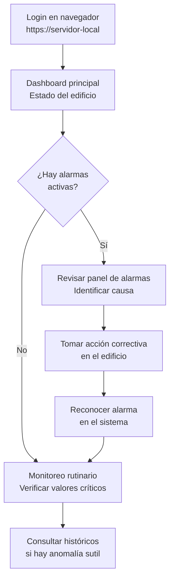

## Perspectiva del Operador del Cliente

El operador del cliente solo usa el dashboard en el navegador — no administra nada del sistema.

### Flujo de trabajo diario

### Acciones disponibles por rol

Los roles de operación (Visor, Operador) tienen alcance limitado al proyecto de la instalación; el rol de Admin-Integrador es global a la instancia (ver SRV-ADR-020).

| Acción | Visor | Operador | Admin-Integrador |
|---|---|---|---|
| Ver dashboards y mimics | ✅ | ✅ | ✅ |
| Ver históricos y gráficas | ✅ | ✅ | ✅ |
| Ver alarmas activas | ✅ | ✅ | ✅ |
| Reconocer alarmas | ❌ | ✅ | ✅ |
| Enviar comandos de escritura (setpoints) | ❌ | ✅ (sobre puntos `read_write`) | ✅ |
| Configurar dispositivos y asociar puntos | ❌ | ❌ | ✅ |
| Agregar usuarios | ❌ | ❌ | ✅ |
| Exportar/importar proyecto | ❌ | ❌ | ✅ |
| Acceder a scripts de lógica | ❌ | ❌ | ✅ |
| Consultar al Agente del Cliente (IA) | ❌ | ✅ | ✅ |
| Consultar al Agente del Integrador (IA) | ❌ | ❌ | ✅ |

---

## Comunicación con Integradores

### Canal de soporte

| Tipo de solicitud | Canal | Tiempo de respuesta objetivo |
|---|---|---|
| Bug crítico (sistema caído) | Email directo a cjhirashi | < 4 horas |
| Bug no crítico | Email directo | < 48 horas |
| Pregunta de uso / configuración | Email directo | < 72 horas |
| Solicitud de feature | Registrar en lista de mejoras del proyecto | Sin SLA |

### Información mínima para reportar un bug

1. Versión de Hira Server/Studio afectada
2. SO del servidor (Windows / Linux)
3. Perfil de instalación (local del integrador / producción comercial)
4. Descripción del comportamiento esperado vs. observado
5. Pasos para reproducir (si aplica)
6. Crash report ID (si el sistema lo generó automáticamente)
7. Captura de pantalla del error (si es visible en el panel)

---

## Gate de Salida

- [ ] Proceso de gestión de licencias probado end-to-end (emisión → activación → validación)
- [ ] Al menos un integrador piloto operando su primera instalación sin asistencia directa
