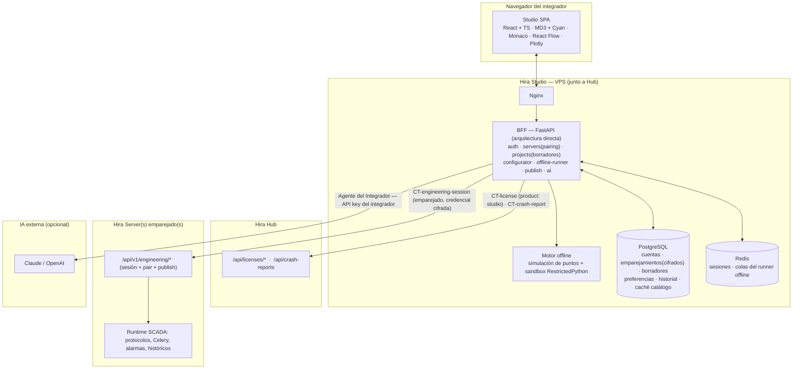

## Contenedores

## Módulos del BFF

| Módulo | Responsabilidad | Anclas |
|---|---|---|
| `auth` | Cuentas de integrador, vínculo con licencia de Hub, JWT de sesión, degradación a solo lectura | `STU-ADR-002` |
| `servers` | Registro de Servers, emparejamiento por token, almacén cifrado de credenciales, revocación | `STU-ADR-003` |
| `projects` | Borradores de diseño: dispositivos-simulador, puntos, asociaciones, scripts, mimics, alarmas; versionado local | `STU-ADR-004` |
| `configurator` | API de edición del borrador (equivalente al Configurador de Server, sobre el borrador) | `STU-ADR-004`, hereda de `spec/hira-server/` |
| `offline-runner` | Motor de simulación de puntos + sandbox RestrictedPython; ejecuta lógica y pruebas del borrador | `STU-ADR-004` |
| `publish` | Serializa el borrador a paquete de proyecto (`.hira` extendido) y lo carga al Server por la sesión de ingeniería; orquesta el mapeo simulador→real | `STU-ADR-004` |
| `ai` | Agente del Integrador (API key del integrador cifrada), tools offline/online/Hub, `ai_usage_log` propio, fallback a modelo interno | `STU-ADR-005` |
| `core` | config, logger JSON (mismo estándar), security, database | ecosistema |

## Fronteras

- **Aislamiento multi-tenant:** todo acceso a datos del BFF filtra por `integrator_id` del
  JWT. Es la frontera de seguridad de `STU-ADR-001` — se verifica con pruebas `AC-STU-*`.
- **Offline vs en línea:** el `offline-runner` nunca toca un Server ni un dispositivo
  real; el runtime de producción es exclusivo del Server (`E-ADR-001`, `STU-ADR-004`).
- **Credenciales de Server:** cifradas en reposo (`STUDIO_PAIRING_ENCRYPTION_KEY`), nunca
  en logs, nunca expuestas al SPA.
- **Contrato con Server:** solo `CT-engineering-session` (ampliado). Studio no llama a
  otros endpoints del Server fuera de la sesión de ingeniería.

## Paridad con Hira Server

El Configurador, el modelo de puntos/asociaciones, la API `hira` de scripts y el formato
de mimic se **especifican en `spec/hira-server/`** y Studio los **implementa**, no los
redefine. Índice de qué se hereda: `inherited-from-server.md`.
